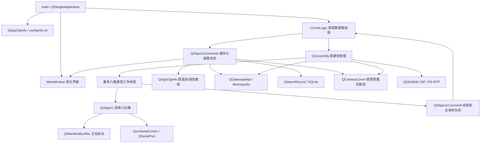

# 在 v4 基础上的改动位置

本次修改的基线是最新上传的 `MyOverFlow_RK3399适配版_v4.zip`，不是上一次另建的独立工程。v4 已经源码实现的串口和单实例类继续参与编译，移除交付中的旧 Windows DLL、IDE 用户配置和生成的 ui 头文件仅为清理构建产物，不是替换业务架构。

## 保留的主调用关系

## 原类的职责及修正

| 原文件/类 | 实际修改 |
|---|---|
| main.cpp | 仍实例化 `QtSingleApplication`、读取 `QAppCfgInfo`、初始化/启动 `CCoreLogic`、显示 `MainWindow`；增加显式 INI 路径、模拟/校验选项、退出清理与数据目录实例锁 |
| AppFunc/corelogic.* | 保留 QThread 和 50 ms 核心循环；将原来的计数器假业务改为处理采样、报警及原遥测/遥信数组；停止时等待通信线程退出并排空待处理事件 |
| AppFunc/object1commintf.* | 原通信接口扩展为统一缓存；线程队列不直接触碰 UI；每个测点保存值、原始寄存器、有效性、时间、报警及通信错误；增加原子计数器与互斥保护 |
| CommObj/commobj.* | 不再只打开端口 0；在原管理类下创建最多八个工作线程；网络/视频服务仍由该类初始化和关闭 |
| CommObj/Object1/object1.* | 仍调用 v4 的 QextSerialComm；从机接收路径纠正为主站事务，支持分包、CRC、异常响应、超时重试、断口重开；对象和串口均在各自工作线程创建/销毁 |
| CommObj/qmainmodbusrtu.* | 保留原读写接口；CRC 统一为标准 Modbus、低字节先发送；修正单寄存器 7 字节响应、读取索引及越界问题；缓存支持从站地址 247，旧 512 字寄存器数组有边界检查 |
| ConfigInfo/appcfginfo.* | 保留单例、原数组和 INI 入口；全部字段初始化；设备/串口数量校验；继续同步 m_AllMeasVal、m_AllLetterVal 及 Report 数组 |
| ComnUtils/SerialComm/extserialport.* | 在 v4 的 QSerialPort 包装器增加阻塞等待、明确错误状态；Polling 模式不在 readyRead 槽中提前消费数据；原事件模式队列有界 |
| ComnUtils/SingleApp/qtsingleapplication.cpp | 保留 v4 实现，补上本地连接断开后的释放；主程序另加数据目录 QLockFile，防止重复实例争用采集资源 |
| UserIntf/mainwindow.* / mainwindow.ui | 原 MainWindow 继续为产品窗口；参考 HMI 深绿色导航/列表/视频设计，以 Qt5 API 接入原缓存和通信对象，不依赖 HMI 的外部登录/API 服务 |
| UserIntf/dialogconfigdev.* / dialogconfigdev.ui | 保留原类与 tableViewUart、tableViewDev、tableViewLetter、tableViewMeas 等对象名/配置入口；扩展设备、阈值、摄像头、MQTT、录像与 GB 参数 |
| 原 .pro / .pri | 原 include 分层继续使用；增加所需 Qt 模块和 libmosquitto 链接，新模块加入对应层的 .pri |

`ModbusRtu`、`Object2` 源码继续保留供旧接口兼容，不在本版产品采集链中实例化。旧 Object2 的 Linux STOP_1_5 枚举编译问题作平台条件修复。不能把旧从机类继续用于新的主站采集，故活动的主站协议由原 QObject1/QMainModbusRtu 路径负责。

## 新增文件的位置

- `ConfigInfo/monitorconfig.*`：属于原配置层的值结构、INI 校验和原子写入辅助函数，不是另一个配置服务。
- `AppFunc/alarmrecord.*`：SQLite 报警记录；与原核心逻辑通过排队信号连接，数据库连接保持在其创建线程。
- `CommObj/gatewaymqtt.*`：真实 libmosquitto 的线程网络循环；回调通过带连接代次的排队调用回到管理线程，防止旧连接事件影响新连接。
- `CommObj/Video/cameracomm.*`：海康 ISAPI、独立 FFmpeg 录像进程及磁盘回收。
- `CommObj/Video/gb28181.*`：GB2016 UDP SIP、XML、H.264 PS/RTP；读取同一份 QAppCfgInfo 设置值。
- `UserIntf/Video/gstmpprtspplayer.*`：从上传 HMI 保留的可选 GStreamer 预览接口，适配 Qt5，并防止切换流后的旧帧进入新预览。
- `UserIntf/hmi.qss` / `.qrc`：参考 HMI 样式；报警使用红色卡片，传感器值和串口信息分行显示。
- `tests/`、`scripts/`、`docs/`：测试、构建启动辅助及部署说明，不改变产品分层。

配置的运行时副本在启动后保持不变。对话框保存新的 INI 不直接写正在采集的对象；重启后加载，避免一个线程读到一半旧参数、一半新参数。UI 和 MQTT 应使用 QObject1CommIntf 的加锁快照，不能无锁读写公开的旧数组；旧整数遥测数组只保留兼容用途，带小数的真实值以新快照中的 double 为准。

本次未对公开 GitHub 分支作任何更新。之前公开的旧版分支是否保留，需要由用户另行决定；本地生成新版不代表已经删除公开版本。
